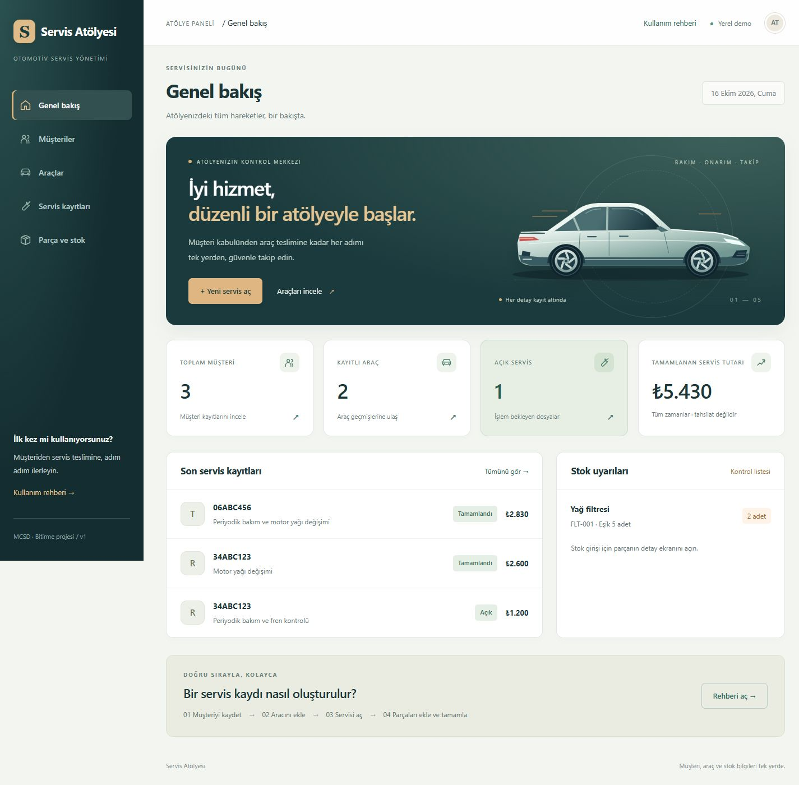

# Servis Atölyesi
## Automotive Service Management System

**Ahmet Turan · MCSD bitirme projesi**

**Teslim biçimi:** bilgisayarda yerel çalıştırma. Canlı yayın veya hosting gerektirmez. [ZIP'i çıkartma ve bilgisayarda açma adımları](docs/BILGISAYARDA-CALISTIRMA.md).

Türkçe bir otomotiv servis yönetim uygulaması. Müşteri ve araç kayıtları, servis işlemleri, yedek parça stoğu ve genel bakış ekranı birlikte çalışır.



### Hızlı başlangıç

Gereken: **.NET 10 SDK** (yalnızca runtime yeterli değildir). İlk çalıştırmada NuGet paketleri için internet gerekir. SQL Server kurulumu gerekmez; EF Core, ilişkisel SQL veritabanı SQLite kullanır. Visual Studio ile çalışmak için .NET 10 destekli sürüm ve ASP.NET geliştirme iş yükü gerekir.

Kaynak ZIP'ini bir klasöre çıkarın. Terminali solution dosyasının bulunduğu klasörde açın:

```powershell
dotnet restore AutomotiveServiceManagement.sln
dotnet build AutomotiveServiceManagement.sln
dotnet run --project src/Web.UI --no-launch-profile --urls http://127.0.0.1:5180
```

Tarayıcıda **http://127.0.0.1:5180** adresini açın. İlk açılışta migration uygulanır, veritabanı ve kurgusal örnek veriler otomatik oluşturulur. Sonraki açılışlar kayıtları korur. Terminalde Ctrl+C ile kapatın. İsteğe bağlı `Start.ps1` aynı işlemi başlatır.

### Özellikler

- Müşteri: liste, arama, detay, ekleme, düzenleme, ilişkiler uygunsa silme.
- Araç: müşteri ilişkisi, benzersiz normalize plaka, kilometre doğrulaması ve servis geçmişi.
- Servis: kabul tarihi, kilometre, iş açıklaması, işçilik, kullanılan parçalar, tamamla ve iptal.
- Parça/stok: kod, fiyat, stok girişi, kritik eşik; servis kullanımıyla otomatik çıkış, iptalde tek seferlik iade.
- Dashboard: kayıt sayıları, açık dosyalar, tamamlanan servislerin tutarı ve kritik stok.
- Türkçe doğrulama ve yardım; responsive HTML/CSS ve yerel Bootstrap. CDN bağımlılığı yoktur.

### Basit çalışma akışı

1. Müşteriler → Yeni müşteri.
2. Araçlar → Yeni araç; müşteriyi seçin.
3. Parça ve stok → Yeni parça; fiyatı `125,50` biçiminde girin. Detaydan stok girişi yapın.
4. Araç detayından Servis aç. Yeni kilometre mevcut değerden düşük olamaz.
5. Servis detayından parçaları ve miktarları ekleyin. Aynı parça bir kez eklenebilir.
6. Tamamla ile dosyayı kapatın. Hatalı açık dosyayı İptal et ile kapatıp yeniden açabilirsiniz. İptalde parçalar stoğa döner.

Tamamlanan/iptal dosya değişmez; servis geçmişi silinmez. Dashboard tutarı tahsilat, fatura veya muhasebe kaydı değildir. Vergi, indirim, kimlik doğrulama ve dosya yükleme v1 kapsamında değildir.

### Mimari

```text
AutomotiveServiceManagement.sln
src/
  Core/       Entity, form modelleri, servis arayüzleri
  Data/       DbContext, EF Core migrations, örnek veri
  Business/   Interface uygulamaları, doğrulama, LINQ ve iş kuralları
  Web.UI/     ASP.NET Core MVC, controller, Razor, Bootstrap ve CSS
tests/
  IntegrationTests/   Gerçek SQLite kullanan çalıştırılabilir test paketi
docs/          Şartname, ER modeli, kullanım ve doğrulama raporu
screenshots/   Gerçek uygulama ekranları
tools/         HTTP testi ve kaynak paketleme aracı
```

Bağımlılıklar: Web.UI → Business + Data → Core; Business ayrıca Data kullanır. Controller'lar arayüzlerle çalışır; servisler DI ile eklenir. Genel repository veya ek mimari çerçeve kullanılmaz. EF Core ve C# kaynak kodu kasıtlı olarak doğrudandır.

### Veritabanı ve güvenilirlik

[ER modeli](docs/ER-MODEL.md) · [v1 şartnamesi](docs/MASTER-SPECIFICATION-v1.md)

SQLite dosyası `src/Web.UI/App_Data/service.db` altında oluşturulur ve Git/teslim kaynak paketine alınmaz. Para `int` kuruş olarak tutulur; toplam `long` ile hesaplanır. Servis satırı ekleme anındaki fiyatı saklar. Benzersiz indeksler, foreign key ve CHECK kısıtları veri bütünlüğünü destekler. Stok ve durum değişiklikleri transaction içindedir. Guid concurrency token eski ekranların veriyi ezmesini önler.

POST işlemleri global `AutoValidateAntiforgeryToken` filtresiyle korunur. Razor form tag helper token üretir. Ayrı form modelleri istenmeyen alanların değiştirilmesini önler; sunucu tarafında DataAnnotations ve iş kuralları tekrar doğrulanır. GET veri değiştirmez.

Bu sürüm **yerel eğitim demosudur**. İnternete açılmadan önce kullanıcı kimliği, yetkilendirme, HTTPS ve dağıtım ayarları eklenmelidir. Varsayılan veri yolu dışında bağlantı gerektiğinde `ConnectionStrings__ServiceDb` ortam değişkenini veya user-secrets kullanın; gerçek bağlantı bilgilerini kaynak dosyalara yazmayın. Boş veritabanı için `SeedDemoData=false` ayarlanabilir.

Yedek: uygulamayı kapatıp `App_Data` klasörünü kopyalayın. Geri yükleme: uygulama kapalıyken aynı klasöre geri koyun. Kaynak ZIP'i kişisel/veritabanı yedeği değildir.

### Test ve doğrulama

```powershell
dotnet build AutomotiveServiceManagement.sln
dotnet run --project tests/IntegrationTests --no-build
# İsteğe bağlı HTTP testi: Python 3 standart kütüphanesi yeterlidir.
python tools/http_smoke.py
```

Entegrasyon paketi normal bir console uygulamasıdır; `dotnet test` yerine yukarıdaki `dotnet run` komutuyla çalışır. Başarısız senaryo programı hata koduyla durdurur. Testler demo veritabanını değiştirmez; bellek içi/geçici gerçek SQLite kullanır. HTTP testi 5181 portunu kullanır.

[Doğrulama raporu](docs/VALIDATION.md) · [Türkçe kullanım kılavuzu](docs/KULLANIM.md) · [Sunum ve savunma notları](docs/SAVUNMA.md)

Migration yenilemek için:

```powershell
dotnet tool restore
dotnet ef migrations add DegisiklikAdi --project src/Data --startup-project src/Web.UI
```

Başlangıç migration'ı kaynakta bulunur; normal kullanımda EF aracını çalıştırmaya gerek yoktur.

### Teslim

Resmi MCSD.pdf okunarak database + OOP + HTML/CSS + ZIP ve ayrıca screenshot gereksinimleri şartnameye işlendi. İki dosya adında öğrenci adı-soyadı bulunmalıdır.

```powershell
python tools/package_source.py --student "Ahmet Turan"
```

`output/Ahmet_Turan_AutomotiveServiceManagement.zip` ve ayrıca `output/Ahmet_Turan_Screenshot.jpg` oluşturulur. ZIP kaynak kodunu, belgeleri ve görüntüleri içerir; bin/obj, paket önbelleği, yerel DB ve secrets içermez. GitHub için kaynak dosyalar ve README hazırdır; bu çalışma GitHub'a yayımlama veya e-posta gönderme işlemi yapmaz.

### Telefon ve tablet kullanımı
Arayüz telefon, tablet ve bilgisayarda uyumlu yerleşim kullanır. 73 sayfa/ekran boyutu kontrolü yapıldı; fiziksel cihaz ve farklı tarayıcı motorları ayrıca doğrulanmalıdır. 1024 px ve altında üst menü ve dokunmaya uygun düğmeler kullanılır; tablolar kendi içinde yana kaydırılır. [Cihaz testi ve hocanın erişim koşulları](docs/CIHAZ-UYUMLULUGU.md).

`127.0.0.1:5180` yalnızca uygulamanın çalıştığı cihazda açılır. Hocanın uzaktan telefon/tablet kontrolü için çalışan bir sunucu adresi gerekir; ZIP/GitHub bağlantısı siteyi çalıştırmaz. Mevcut uygulama henüz internette yayımlanmamıştır.

Nihai teslim bilgisayarda yerel inceleme içindir; hosting/canlı bağlantı bu teslimin kapsamında değildir. Responsive tasarım korunmuştur.

### Teknik başvuru

[Microsoft MVC ve EF Core modeli](https://learn.microsoft.com/en-us/aspnet/core/tutorials/first-mvc-app/adding-model?view=aspnetcore-10.0), [MVC validation](https://learn.microsoft.com/en-us/aspnet/core/tutorials/first-mvc-app/validation?view=aspnetcore-10.0), [Anti-forgery](https://learn.microsoft.com/en-us/aspnet/core/security/anti-request-forgery?view=aspnetcore-10.0). Bootstrap, MVC şablonuyla gelen yerel lisansıyla kullanılır.
