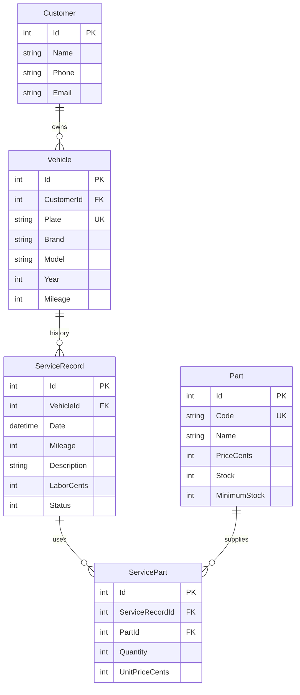

# İlişkisel model

Tüm varlıklarda Guid Version eşzamanlılık işaretidir. Para int kuruş olarak saklanır; kayan nokta hatası oluşmaz. İlişkiler Restrict ile korunur. Servis toplamı işçilik + miktar × o tarihteki fiyat toplamıdır. Stok değişimi ve servis durumu tek transaction içinde kaydedilir. Negatif tutar/stok ve sıfır miktar CHECK ile engellenir.
